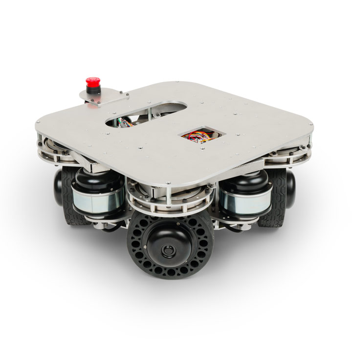

# fwdsローバーの3Dモデルのパッケージ

<p align="center">
  
</p>

## 準備
ヴイストンの台車ロボットのオプションを表示する場合は、`vs_rover_options_description`というパッケージを`src`フォルダーにクローンしてください。（詳細は[こちら](https://github.com/vstoneofficial/vs_rover_options_description.git)を参照してください）
```bash
git clone https://github.com/vstoneofficial/vs_rover_options_description.git
```
1. 対応するオプション
   - LRF TG30

2. 使用状況に応じて、[x40a.xacro](./urdf/x40a.xacro)ファイルの8行目にある使用しないオプションをコメントアウトしてください。

## RViz上の可視化
以下のコマンドで立ち上げます。

```bash
ros2 launch fwdsrover_description display.launch.py
```
